<div align="center">



</div>

## `▌SYSTEM://00` — THE MISSION

RADAR is a job-intelligence engine that runs 24/7. It does everything except the final click.

```diff
+ finds jobs from 23 feeds and every funded startup it can discover on StartupMap and YC's hiring list
+ checks every posting is real before it reaches you
+ scores each job against your resume, 0–100
+ saves every 80%+ match to your Vault automatically
+ rewrites your resume, honestly, for 50–79% near-misses (Anthropic · Gemini · Grok)
+ fills each application in one click (↯ HACK) and reads recruiter replies from Gmail
- applying by hand
```

---

## `▌SYSTEM://01` — DISCOVER · funded startups, found politely


Directories say **who** exists; each startup's own job links reveal **which ATS board** to read. RADAR obeys robots.txt,
names itself honestly, sends one request every 1.5s and pauses the moment a site says "slow down".

```text
src/lib/discovery/polite.ts       robots.txt parser + polite fetcher (Crawl-delay, pause on 429/403/503)
src/lib/discovery/startupmap.ts   sitemap · /jobs/<city>/engineering (your cities first) · JSON-LD + job links
src/lib/discovery/ats.ts          link → board: Ashby · Greenhouse · Lever · Workable · Teamtailor · Workday …
src/lib/discovery/run.ts          48h cadence · queue with retries · verifies guesses · links to `companies`
src/lib/discovery/targets.ts      your imports: a CSV (e.g. FundedStartupsDaily's export) or pasted websites
/api/cron/discover                runs it: 01:30 UTC daily + every 6h
```

---

## `▌SYSTEM://02` — INGEST · jobs through public APIs


Every company is read from the feed its own careers page is built on, so the list is complete and a missing job means a
closed job. Only tech titles are kept. Unchanged jobs are never re-embedded, and no single company can hold the run
past 60 seconds.

```text
src/lib/scraper/adapters.ts   11 ATS adapters (Greenhouse, Lever, Ashby, Workable, SmartRecruiters, Recruitee,
                              Personio, Breezy, Teamtailor, Workday, Amazon)
src/lib/scraper/boards.ts     9 boards (HN Who is hiring, Remotive, Remote OK, Arbeitnow, Himalayas, Jobicy,
                              The Muse, Adzuna, Jooble)
src/lib/pipeline/scrape.ts    least recently scraped first · upsert · embed changed · close missing · time caps
```

---

## `▌SYSTEM://03` — DATA · what lives in Supabase


```diff
+ 001–002  core tables, 1024-d vectors
+ 003      every provider, the server-side Vault (match_scores.status), pipeline_runs
+ 004      target roles
+ 005      more boards, C2 · OPS stages, tailored_resumes (OVERCLOCK)
+ 006      resume version per application, gmail_links, ops_events
+ 007      Teamtailor, discovery queue, jobs.verified_at, Vault bar 80, auto-OVERCLOCK
+ 008      portfolio: your links and the projects you built
+ 009      Eightfold, We Work Remotely, Working Nomads; the Application Kit (answers forms ask for)
```

Run them **in order** in the Supabase SQL editor. Each is safe to re-run, and a feature whose migration is missing
degrades gracefully. Every table: [`docs/database.md`](docs/database.md).

---

## `▌SYSTEM://04` — MATCH · one number, zero guesswork


```text
similarity = cos(resume, job)                     # multilingual-e5-large · 1024-d · Pinecone
meaning    = clamp((similarity - 0.72) / 0.16) × 100
skills     = |yours ∩ job's| / |job's| × 100

score  = 0.6 × meaning + 0.4 × skills             # meaning alone if either side lists no skills
score += 10   the title contains one of your target roles
score -= 30   the role asks 5+ years and you have fewer than 4
score -= 15   the role asks 3–5 years and you have fewer than 2
score +=  5   entry-level role and you have 2 years or less
score +=  5   in one of your cities   |   +3 remote, and you want remote
score -= 10   remote you did not ask for   |   −25 anywhere else
score +=  5   posted in the last 4 days   |   −5 after 45 days   |   −10 after 90
score  = round(clamp(score, 0, 100))              # ≥ 80 → Vault · 50–79 → OVERCLOCK
                                                  # a role that asks clearly more years never auto-vaults
```

---

## `▌SYSTEM://05` — VAULT · nothing enters unverified


ATS feeds only list open roles. A job-board posting has its apply link opened first: a 404, a bounce to the home page
or "no longer accepting applications" keeps it out. A page that cannot be read is never treated as closed. Every Vault
job is checked again each day and **leaves the Vault** once it closes. → `src/lib/pipeline/verify.ts`

---

## `▌SYSTEM://06` — OVERCLOCK · honest resume tailoring


For 50–79% near-misses, an AI rewrites your resume for that one job using only what is already true. It lists the
gaps and projects the new score with the same scorer as a scan. Pick any provider; every other configured one is an
automatic fallback:

```bash
AI_PROVIDER=gemini            # anthropic | gemini | grok — who writes first
ANTHROPIC_API_KEY=…           # optional ANTHROPIC_MODEL (default claude-opus-5)
GEMINI_API_KEY=…              # optional GEMINI_MODEL    (default gemini-3.1-pro-preview, then 3.8-flash)
XAI_API_KEY=…                 # optional XAI_MODEL       (default grok-4.7)
```

→ `src/lib/ai/tailor.ts` · `src/lib/overclock.ts`. Auto-OVERCLOCK runs daily under the cap you set in Preferences.

---

## `▌SYSTEM://07` — HACK · one click, the form opens filled


**↯ HACK** on any card (with the **RADAR · Auto-Fill** extension, [`extension/`](extension/README.md)) opens the form
already filled: your facts in about a second, then every question answered (Yes/No, dropdowns, Location, written
answers through HUMANIZE), even on forms RADAR cannot read ahead (Ashby, company sites: the tab reads them), your PDF
attached and Submit marked. You press Submit; the employer's confirmation logs it in C2 · OPS.

**INFILTRATE ▸** is the same run step by step: the tailored CV, then **FORM://INTERCEPT** (RADAR reads the posting's
real form, fills it from your profile and Application Kit and drafts the rest in your voice) for you to review and edit,
then the form. **INFILTRATE ALL** walks the whole Vault. Without the extension, the RADAR FILL bookmark fills the form
from the clipboard. The final submit is always yours. → `RunPanel.tsx` · `src/lib/apply/`

---

## `▌SYSTEM://08` — TRACK · replies move the board


A read-only Gmail link classifies recruiter replies (rejection, assessment, interview, offer) and moves each application
through **C2 · OPS**. Only the verdict is stored, and the token is sealed with AES-256-GCM.
→ `src/lib/gmail.ts` · `src/lib/crypto.ts`

---

## `▌SYSTEM://09` — SCHEDULE · the loop that never sleeps


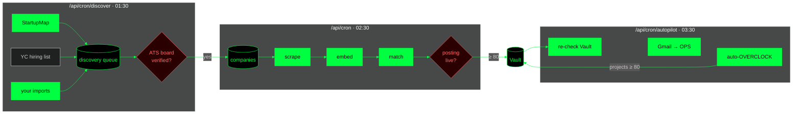

---

## `▌RULES OF ENGAGEMENT`

```diff
+ robots.txt is law: disallowed paths (every directory's /api) are never requested
+ an honest bot name, one request at a time, a 24h pause after 429 / 403 / 503
+ official feeds and APIs first: ATS boards, Adzuna, Jooble
- no LinkedIn or Indeed scraping, and your logins are never used
- no fake browsers, rotating IPs or CAPTCHA solving
- FundedStartupsDaily is not scraped (its Terms forbid it): import its licensed CSV export instead
+ the final submit on every application is yours
```

---

## `▌BOOT SEQUENCE` (local)

```bash
git clone https://github.com/SHAILESH-RS-UPADHYAY/radar && cd radar
npm install
cp .env.example .env.local                              # fill in the keys (table below)
npm run dev                                             # http://localhost:3000
curl -X POST http://localhost:3000/api/cron/discover     # first fill (locally no secret needed)
curl -X POST http://localhost:3000/api/cron
```

Then run migrations **001 → 009** in Supabase and create a Pinecone index `radar-jobs` (1024-d, cosine). Sign up,
upload your resume, pick roles and cities, and press **SCAN NOW**.

## `▌DEPLOY` (Vercel)

In **Vercel → Settings → Environment Variables** (Production), paste values **without quotes**, then redeploy.

| Variable                                                                                   | Needed      | From                                                                             |
| ------------------------------------------------------------------------------------------ | ----------- | -------------------------------------------------------------------------------- |
| `NEXT_PUBLIC_CLERK_PUBLISHABLE_KEY` · `CLERK_SECRET_KEY` · `CLERK_WEBHOOK_SIGNING_SECRET`  | ✅          | Clerk dashboard (webhook: `https://<domain>/api/webhook/clerk`)                  |
| `NEXT_PUBLIC_SUPABASE_URL` · `NEXT_PUBLIC_SUPABASE_ANON_KEY` · `SUPABASE_SERVICE_ROLE_KEY` | ✅          | Supabase → Project Settings → API                                                |
| `PINECONE_API_KEY`                                                                         | ✅          | app.pinecone.io (the same key that works locally)                                |
| `CRON_SECRET`                                                                              | ✅          | any long random string (`openssl rand -hex 32`); without it every run is refused |
| `AI_PROVIDER` + `ANTHROPIC_API_KEY` / `GEMINI_API_KEY` / `XAI_API_KEY`                     | OVERCLOCK   | at least one key; the others become fallbacks                                    |
| `GOOGLE_CLIENT_ID` · `GOOGLE_CLIENT_SECRET` · `GMAIL_TOKEN_KEY`                            | Gmail link  | Google Cloud OAuth (redirect `https://<domain>/api/gmail/callback`)              |
| `NEXT_PUBLIC_SITE_URL`                                                                     | recommended | your public URL                                                                  |
| `ADZUNA_APP_ID` · `ADZUNA_APP_KEY` · `JOOBLE_API_KEY`                                      | optional    | more job-board reach                                                             |

- **Crons:** `vercel.json` runs all three routes daily. For every 6h, add the GitHub secrets `RADAR_URL` and
  `CRON_SECRET`.
- **Clerk:** sign-in URLs are set in code. For a login that never hops through `*.clerk.accounts.dev`, use a Clerk
  production instance on your own domain.
- **Health:** `GET /api/health` shows `pipeline.stale: false` when the loop is alive.

## `▌LAYOUT`

```text
src/
  proxy.ts                  Clerk session gate
  app/
    page.tsx                landing (+ a live JD-terminal demo)
    (site)/                 /system · /protocol · /architecture · /privacy · /terms
    (dashboard)/            DISCOVERY · VAULT · OVERCLOCK · C2 · OPS, onboarding, settings
    api/                    match · dashboard · jobs/:id · vault · ops · overclock · apply/prepare · gmail
                            discovery · settings · cron/discover · cron · cron/autopilot · health · webhook/clerk
  lib/
    discovery/              polite crawler, StartupMap, ATS detection, imports, orchestrator
    scraper/                ATS + board adapters, seeds, htmlToText, skills
    pipeline/               scrape, match, verify, cron auth
    ai/                     embeddings, matcher, tailoring (Anthropic · Gemini · Grok)
    apply/                  read a posting's form, answer it, the fill packet, the RADAR FILL bookmark
    extension.ts            the page side of the RADAR · Auto-Fill extension
    jd.ts                   job description → coloured terminal lines
    gmail.ts · crypto.ts    Gmail sync, AES-256-GCM
    overclock.ts            OVERCLOCK core + auto-OVERCLOCK
  components/               dashboard (cards, JobTerminal, RunPanel), hud, site, settings
extension/                  RADAR · Auto-Fill (Chrome, Manifest V3): one-click apply: every question answered, you press Submit
supabase/migrations/        001 … 009
docs/                       architecture · database · adding a source · readme/ (these panels)
```

## `▌COMMANDS`

| Command                       | Does                                |
| ----------------------------- | ----------------------------------- |
| `npm run dev`                 | dev server                          |
| `npm run check`               | typecheck + lint + tests            |
| `npm run build`               | production build                    |
| `node docs/readme/render.mjs` | re-render the terminal panels above |

<div align="center">

```text
[ OK ] all systems nominal · RADAR is hunting while you sleep
```

</div>
